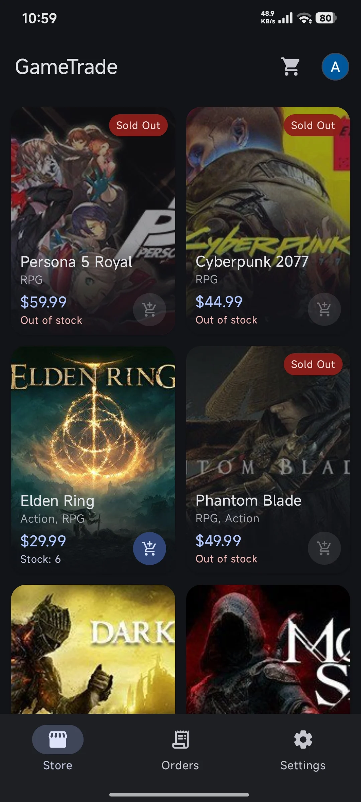
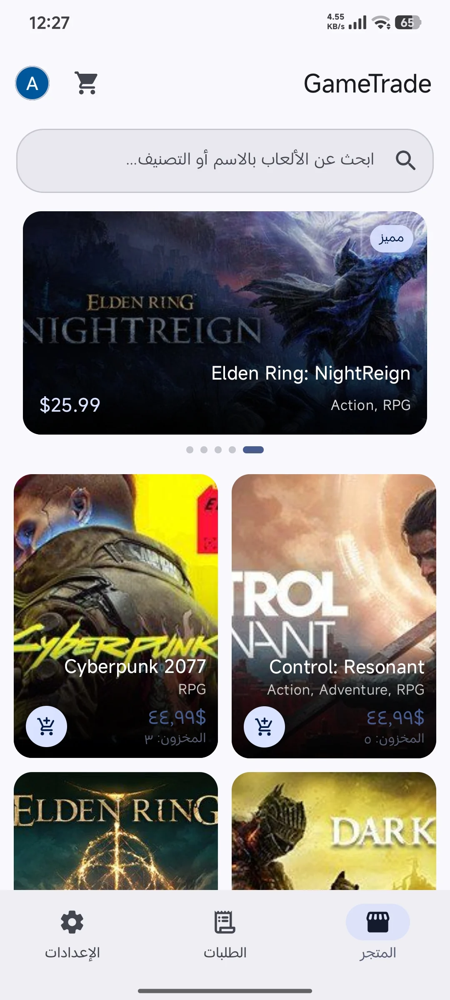
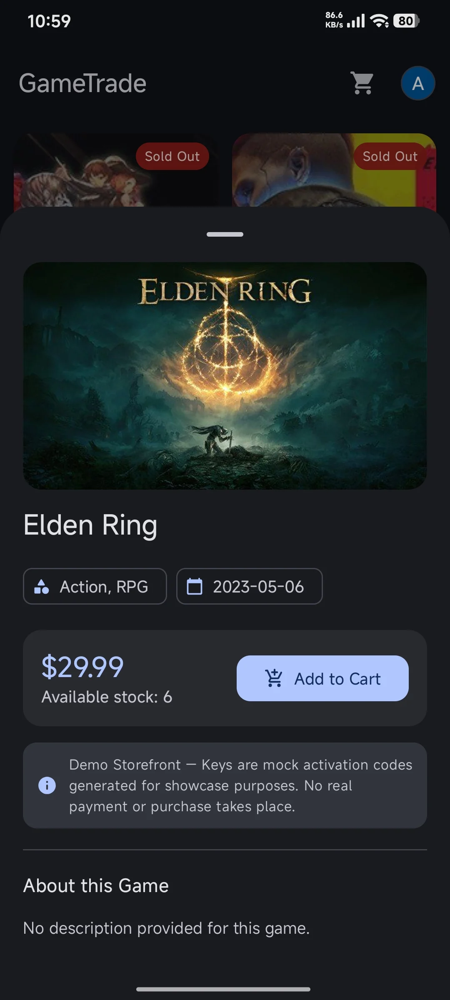
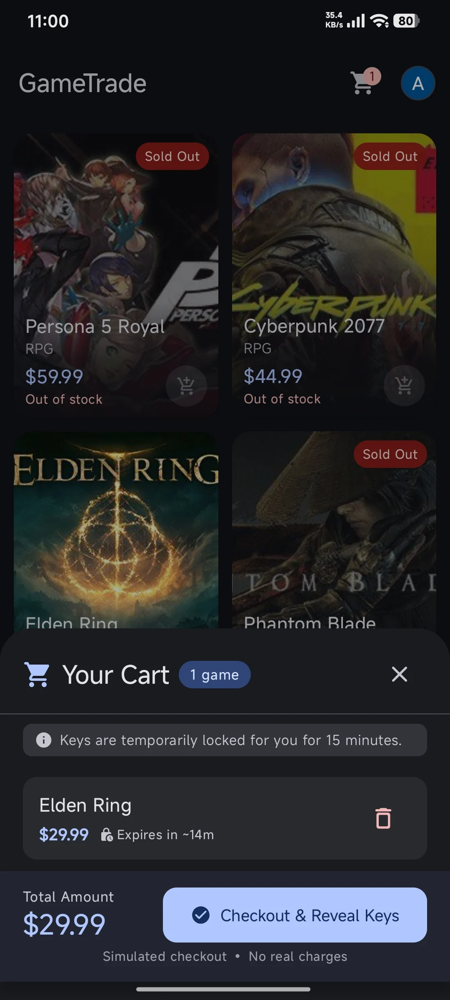
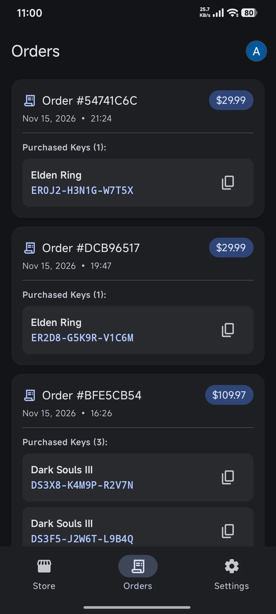
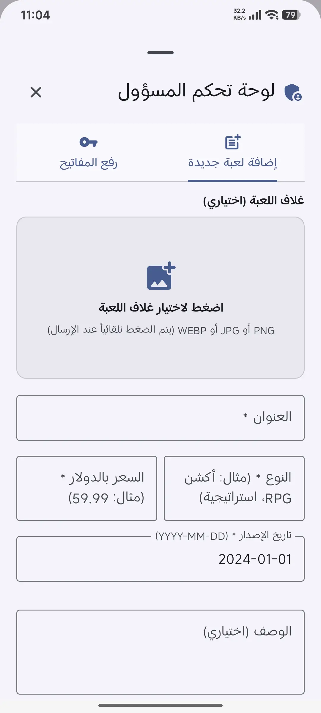
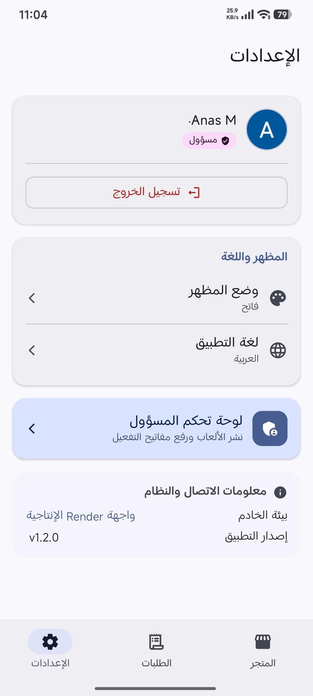
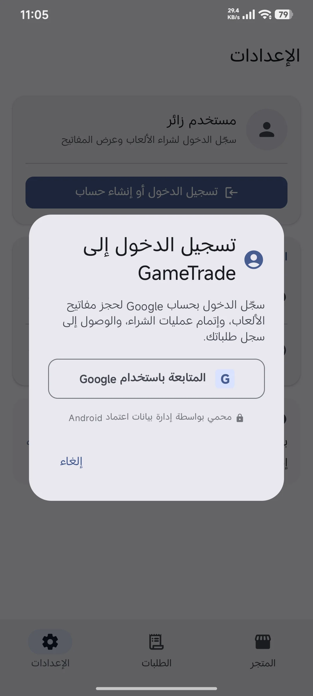
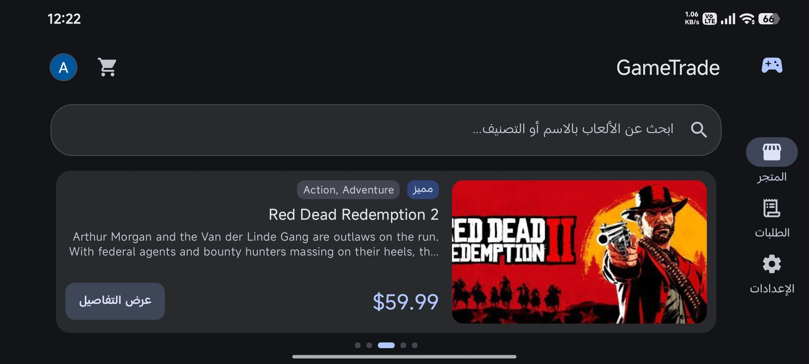
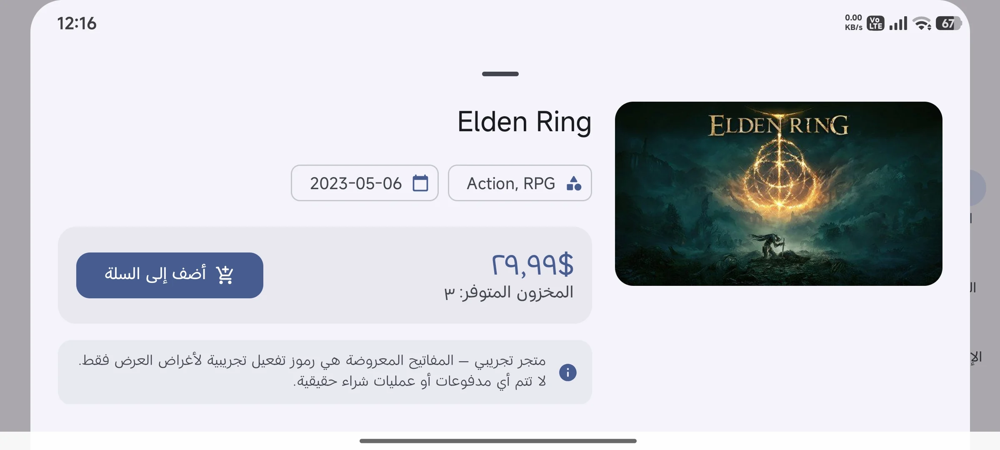

# 🎮 GameTrade Android

[](https://github.com/EngAnasMuhammad/GameStoreAndroid/actions/workflows/ci.yml)
[](https://github.com/EngAnasMuhammad/GameStoreAndroid/releases/latest)
[](https://kotlinlang.org)
[](https://developer.android.com/jetpack/compose)
[](https://ktor.io)
[](LICENSE)

> [!NOTE]
> **Demo Storefront Disclaimer**: GameTrade is a demonstration mobile e-commerce platform engineered to showcase modern Android architecture, reactive inventory locking, and end-to-end commerce flows. All game serial keys are simulated and no real financial payments are collected.

**GameTrade** is a modern, high-performance digital game storefront and activation key distribution Android application. Engineered with **100% Jetpack Compose (Material 3)** and **Kotlin**, GameTrade showcases clean multi-tier architecture, reactive inventory reservations with server-backed key locking, instant digital checkout, Google Sign-In via Android Credential Manager, role-gated admin inventory management, adaptive landscape layouts, and dynamic per-app internationalization (English & Arabic RTL).

---

## 🎬 Demo

<!-- Replace PASTE_GITHUB_VIDEO_ASSET_URL_HERE with your uploaded GitHub MP4 asset URL -->

---

## 📱 Screenshots Gallery

### Portrait Mobile Experience

|                                  Storefront (Dark)                                  |                                  Storefront (Light)                                   |                                 Game Detail Sheet                                  |                                Cart Reservation (15m Lock)                                 |
|:-----------------------------------------------------------------------------------:|:-------------------------------------------------------------------------------------:|:----------------------------------------------------------------------------------:|:------------------------------------------------------------------------------------------:|
|  |  |  |  |

|                                 Order History & Keys                                 |                                     Admin Dashboard                                      |                               Arabic Localization (RTL)                                |                                   Google Sign-In                                    |
|:------------------------------------------------------------------------------------:|:----------------------------------------------------------------------------------------:|:--------------------------------------------------------------------------------------:|:-----------------------------------------------------------------------------------:|
|  |  |  |  |

### Adaptive Landscape Experience

|                            Landscape Storefront (`NavigationRail`)                            |                               Landscape Game Detail (2-Pane Layout)                               |
|:---------------------------------------------------------------------------------------------:|:-------------------------------------------------------------------------------------------------:|
|  |  |

---

## ✨ Key Features

### 🛍️ Digital Commerce & Storefront
- **Dynamic Catalog Grid**: Poster-style game cards featuring responsive aspect ratios, ambient shadow elevation, and translucent vignette panels.
- **Asynchronous Artwork Pipeline**: Powered by Coil with 350ms crossfade transitions, shimmer pulse placeholders, memory-conscious downsampling, and automatic fallback placeholders.
- **Real-Time Stock Reflection**: Live stock counts, instantaneous inventory status transitions, and prominent "Sold Out" badges with dimmed poster art.

### ⏳ 15-Minute Atomic Cart Key Locking
- **Zero Race Conditions**: Adding a game to the cart locks a unique server-side activation key under a temporary 15-minute lease, preventing overselling on limited stock.
- **Live Expiry Telemetry**: Real-time localized countdowns (`Expires in X min`, `Expiring soon`, `Expired`) displayed directly inside the Cart sheet.
- **Optimistic UI Updates**: Instant local cart mutation and item removal with background synchronization.

### 💳 Simulated Checkout & Key Reveal
- **One-Tap Instant Purchase**: Frictionless simulated checkout converting reserved keys into owned digital assets.
- **Instant Key Unmasking**: Immediate purchase receipt modal displaying unmasked serial keys in monospace typography with one-tap clipboard copying.
- **Persistent Order History**: Full historical archive of past transactions with localized timestamps, order identifiers, and perpetual access to purchased game keys.

### 🔐 Next-Gen Identity & Roles
- **Google Sign-In**: Native authentication powered by **Android Credential Manager** (`androidx.credentials`) and **Google ID**, eliminating legacy WebView overhead.
- **Profile Avatar Integration**: Dynamic Google user avatars rendered in the TopAppBar and Settings screen.
- **Role-Based Access Control**: Strict segregation between standard customers (`CUSTOMER`) and administrators (`ADMIN`).
- **Encrypted Local Storage**: JWT tokens and user metadata securely persisted using **Jetpack DataStore Preferences**.

### 🛠️ Administrative Management Suite
- **Role-Gated Dashboard**: Accessible exclusively to verified administrator accounts.
- **Memory-Safe Game Creation**: Client-side image pre-processing with `ImageCompressor` (EXIF orientation correction, bitmap downsampling via `inSampleSize`, and memory recycling) with deferred upload to eliminate orphaned server assets.
- **Batch Key Inventory Replenishment**: Multi-line serial key parser allowing bulk replenishment of game activation keys in seconds.

### 🌐 Theming & Internationalization (I18n)
- **Material 3 Theming**: Complete System Default, Pure Dark, and Crisp Light mode support.
- **Per-App Language Switching**: Seamless in-app switching between English (LTR) and Arabic (RTL) via `AppCompatDelegate.setApplicationLocales`, automatically adapting typography, navigation flows, and layout directionality without requiring device-wide locale changes.

### 📐 Adaptive Layouts & Configuration Resilience
- **Adaptive Navigation**: Automatically transitions between a bottom `NavigationBar` in portrait orientation and a pinned `NavigationRail` in landscape orientation.
- **Two-Pane Adaptive Sheets**: Expands Cart, Game Details, and Admin forms into high-efficiency split-pane layouts in landscape mode.
- **100% Rotation State Preservation**: Employs a unified layout container and `rememberSaveable` state hoisting across all sheets, forms, and tabs. Rotating the device mid-form entry or during sheet interaction never dismisses active dialogs, clears input fields, or loses list scroll positions.
- **Clean Android Lifecycle**: Adheres strictly to native Compose state restoration with zero `android:configChanges` manifest workarounds.

---

## 🏛️ Architecture & Engineering Highlights

GameTrade is built following **Clean Architecture** and **Unidirectional Data Flow (UDF)**:

```
┌─────────────────────────────────────────────────────────────┐
│                    Presentation Layer                       │
│  Jetpack Compose (Material 3) • StateFlow • Compose UDF    │
└──────────────────────────────┬──────────────────────────────┘
                               │ Observes UI State / Sends Intents
┌──────────────────────────────▼──────────────────────────────┐
│                       Domain Layer                          │
│  Domain Models • Repository Interfaces • Business Contracts │
└──────────────────────────────▲──────────────────────────────┘
                               │ Implements Contracts
┌──────────────────────────────┴──────────────────────────────┐
│                        Data Layer                           │
│  GameStoreRepositoryImpl • SettingsRepositoryImpl           │
│  ┌───────────────────────────┴───────────────────────────┐  │
│  │ Remote Data Source: Ktor Client (OkHttp Engine)      │  │
│  │ Local Data Source:  Jetpack DataStore Preferences    │  │
│  └───────────────────────────────────────────────────────┘  │
└─────────────────────────────────────────────────────────────┘
```

- **Clean Layer Decoupling**: The remote HTTP client (`GameStoreApi`) is decoupled from local persistence (`TokenManager`). `GameStoreRepositoryImpl` orchestrates networking and session token caching.
- **Ktor Client 3.x Engine**:
  - OkHttp Engine with custom connection pooling.
  - Non-blocking JSON content negotiation via `kotlinx.serialization`.
  - Resilient socket and connect timeouts (15s request/socket, 10s connect) preventing hanging network threads.
  - Conditional logging (`LogLevel.BODY` in debug builds, `LogLevel.NONE` in release builds).
- **Memory & Resource Discipline**:
  - Stable Compose keys (`key = { it.id }` / `key = { it.keyId }`) across Lazy grids and columns to avoid unnecessary recomposition.
  - Strict bitmap downsampling in `ImageCompressor` preventing `OutOfMemoryError` (OOM) when handling high-resolution 4K/8K mobile camera uploads.
- **Production Hardening**:
  - R8 full-mode minification and aggressive resource shrinking enabled for release builds.
  - Tailored ProGuard keep rules for Ktor serialization, DataStore, and Credential Manager.
  - `android:allowBackup="false"` to prevent token exfiltration via ADB backup or cloud extraction.
  - Strict network security configuration enforcing HTTPS in production.

---

## 🛠️ Tech Stack

| Domain                | Technology / Library                                                                                  | Purpose                                                               |
|-----------------------|-------------------------------------------------------------------------------------------------------|-----------------------------------------------------------------------|
| **Language**          | [Kotlin 2.0.21](https://kotlinlang.org/)                                                              | Modern, expressive, and safe language foundation                      |
| **UI Framework**      | [Jetpack Compose](https://developer.android.com/jetpack/compose) (BOM 2024.09.00)                     | Modern declarative UI toolkit                                         |
| **Design System**     | [Material 3](https://m3.material.io/)                                                                 | Dynamic color, responsive components, typography                      |
| **Networking**        | [Ktor Client 3.0.1](https://ktor.io/)                                                                 | High-performance asynchronous HTTP client with OkHttp engine          |
| **Serialization**     | [Kotlinx Serialization](https://github.com/Kotlin/kotlinx.serialization)                              | Reflection-free, compile-time JSON parsing                            |
| **Image Loading**     | [Coil Compose 2.7.0](https://coil-kt.github.io/coil/)                                                 | Lightweight asynchronous image loader with memory caching             |
| **Authentication**    | [Android Credential Manager](https://developer.android.com/training/sign-in/credential-manager)       | Native Google Sign-In & Passkey authentication API                    |
| **Local Persistence** | [Jetpack DataStore Preferences](https://developer.android.com/topic/libraries/architecture/datastore) | Asynchronous, thread-safe transactional key-value storage             |
| **Architecture**      | Clean Architecture + MVVM / UDF                                                                       | Separation of concerns, testability, and state predictability         |
| **Code Shrinking**    | R8 / ProGuard                                                                                         | Dead-code elimination, obfuscation, and APK size minimization         |
| **CI / CD**           | GitHub Actions                                                                                        | Automated linting, test validation, and signed APK release generation |

---

## 🚀 Getting Started & Local Setup

### Prerequisites
- **Android Studio**: Ladybug (2024.2.1)+ or Meerkat (2024.3.1)+
- **JDK**: Java 17
- **Android SDK**: Compile SDK `37`, Target SDK `37`, Min SDK `26` (Android 8.0 Oreo)
- **Backend Service**: Running instance of the GameTrade Ktor Backend (local or deployed).

### 1. Clone the Repository
```bash
git clone https://github.com/EngAnasMuhammad/GameStoreAndroid.git
cd GameStoreAndroid
```

### 2. Configure `local.properties`
Create or update `local.properties` in the root directory (this file is git-ignored):

```properties
## Android SDK Path
sdk.dir=C\:\\Users\\username\\AppData\\Local\\Android\\Sdk

## Backend API Base URL
# For Android Studio Emulator connecting to local host:
BASE_URL=http://10.0.2.2:8080

# For Physical Device over Wi-Fi / Local Network:
# BASE_URL=http://192.168.1.X:8080

# For Live Production Backend:
# BASE_URL=https://gamestore-backend.onrender.com

## Google Sign-In OAuth 2.0 Web Client ID (from Google Cloud Console)
GOOGLE_WEB_CLIENT_ID=your-google-web-client-id.apps.googleusercontent.com
```

### 3. Build & Run
Compile and deploy the debug build via Android Studio or using the Gradle wrapper:

```bash
# Compile and assemble Debug APK
./gradlew assembleDebug

# Run unit test suite
./gradlew testDebugUnitTest
```

---

## 📦 Automated Release Signing & CI/CD

GameTrade features an automated deployment pipeline managed via [GitHub Actions](.github/workflows/):

- **Continuous Integration (`ci.yml`)**: Automatically triggers on pushes and PRs to `main`, validating compilation, lint checks, and unit tests.
- **Signed Release Pipeline (`release.yml`)**: Triggers when a version tag (`v*.*.*`) is pushed. It injects release signing credentials from GitHub Secrets, compiles an R8-minified production APK, and automatically generates a [GitHub Release](https://github.com/EngAnasMuhammad/GameStoreAndroid/releases) with the signed APK attached.

### GitHub Actions Secrets Configuration
To enable the automated release workflow in your fork or repository:

| Secret Key             | Description                              | Example                        |
|------------------------|------------------------------------------|--------------------------------|
| `KEYSTORE_BASE64`      | Base64-encoded release `.jks` file       | `base64 -w 0 release.jks`      |
| `KEYSTORE_PASSWORD`    | Master password for the release keystore | `********`                     |
| `KEY_ALIAS`            | Key alias identifier inside the keystore | `gamestore-key`                |
| `KEY_PASSWORD`         | Password for the key alias               | `********`                     |
| `BASE_URL`             | Production API endpoint URL              | `https://api.yourdomain.com`   |
| `GOOGLE_WEB_CLIENT_ID` | Production Google Web Client ID          | `*.apps.googleusercontent.com` |

---

## 📜 Changelog & Milestones

- **`v1.3.0`**
  - **Adaptive Landscape Experience**: Integrated Material 3 `NavigationRail` for landscape mode, recovering vertical space with safe-drawing cutout handling, and two-pane horizontal split sheets for Game Details, Cart, and Admin Dashboard.
  - **Screen Rotation State Preservation**: Audit and conversion of active navigation, open sheets, selected game IDs, and typed form inputs to `rememberSaveable` to survive orientation changes seamlessly.
  - **Storefront Scroll Performance & Image Caching**: Configured `GameStoreApplication` with Coil singleton image loader (25% RAM memory cache, 100MB disk cache, hardware bitmaps), eliminated dynamic drop-shadow GPU overdraw, removed animation crossfade lag on scroll, and hoisted gradient brushes and context.
  - **Visual Asset Showcase**: Added 10 high-resolution `.webp` screenshots across portrait and landscape orientations, plus demo storefront disclaimers on simulated checkout flows.
- **`v1.2.0`**
  - **Clean Architecture Refactor**: Introduced `GameStoreRepository` and `SettingsRepository`, completely decoupling HTTP networking from DataStore token mutation.
  - **Per-App Internationalization**: Added Arabic (RTL) and English (LTR) language switching via `AppCompatDelegate.setApplicationLocales`.
  - **Dynamic Theming**: Added Material 3 System Default, Pure Dark, and Crisp Light themes.
  - **Branding**: Updated app display name to `GameTrade` with refreshed vector icons and launcher graphics.
- **`v1.1.0`**
  - Cloud backend integration with Render, Neon PostgreSQL, and Supabase Storage.
  - Automated signed release APK generation workflow with R8 optimizations.
- **`v1.0.0`**
  - Initial MVP release featuring Compose storefront, 15-minute atomic key locking, Google Sign-In, and Admin inventory dashboard.

---

## 📄 License
This project is open-source and distributed under the [MIT License](LICENSE).
